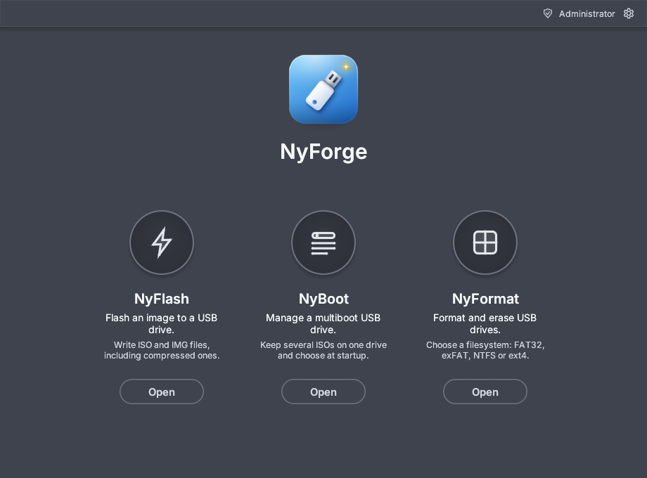
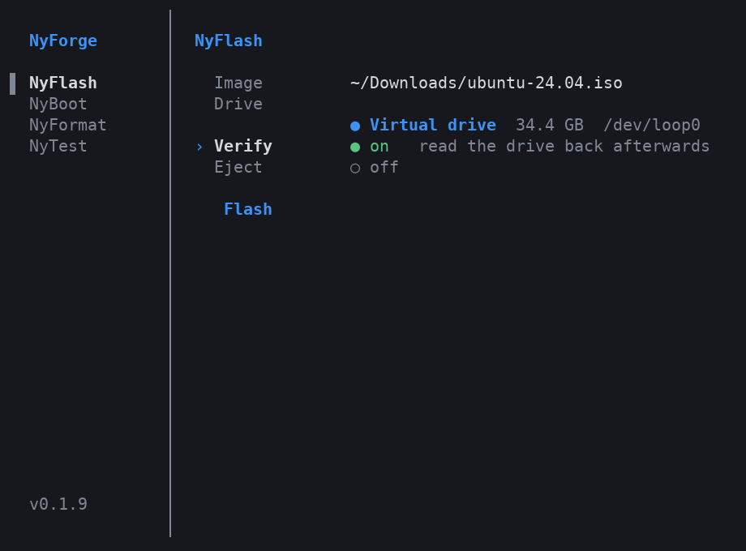

<p align="center"></p>

<h1 align="center">NyForge</h1>

<p align="center">
  <b>A fast, small, native USB toolkit for Linux and Windows.</b><br>
  Flash images · build a multiboot drive · format and repair USB sticks · test speed and health<br>
  <sub>Rust · no telemetry · no account · GPL-3.0-or-later</sub>
</p>

<table>
  <tr><th width="50%">GUI</th><th width="50%">TUI</th></tr>
  <tr>
    <td><a href="docs/screenshots/home.png"></a></td>
    <td><a href="docs/screenshots/tui.png"></a></td>
  </tr>
</table>

## 📑 Contents

1. [What is NyForge?](#1-what-is-nyforge)
2. [Install](#2-install)
   * [2.1 Linux](#21-linux) · [2.2 Windows](#22-windows) · [2.3 Downloads](#23-downloads) · [2.4 What Linux needs](#24-what-linux-needs)
3. [Using the app](#3-using-the-app)
   * [3.1 NyFlash](#31--nyflash) · [3.2 Windows ISOs](#32--windows-isos) · [3.3 NyBoot](#33--nyboot) · [3.4 NyFormat](#34--nyformat) · [3.5 NyTest](#35--nytest) · [3.6 Settings](#36--settings)
4. [Command line and terminal app](#4-command-line-and-terminal-app)
5. [Platform status](#5-platform-status)
6. [Warnings and limits](#6-warnings-and-limits)
7. [Build, contribute, license](#7-build-contribute-license)

## 1. What is NyForge?

| | Tool | What it does |
|---|---|---|
| ⚡ | **NyFlash** | Writes `.iso` / `.img` (and `.gz` `.xz` `.bz2` `.zst` `.zip` of them) to a drive, makes **Windows installers**, verifies the result, checks download checksums. |
| 🧰 | **NyBoot** | Multiboot drive: install once, copy ISOs on like files, pick one at boot. |
| 🧹 | **NyFormat** | Formats USB sticks and SD cards (FAT32, exFAT, FAT16, NTFS, ext2/3/4), checks bad blocks and fake capacity, **repairs** broken drives. |
| 📊 | **NyTest** *(optional: switch it on in Settings)* | Speed test in the style of CrystalDiskMark (with IOPS and latency), sustained-write graph, surface scan, a check that the drive really has the capacity it claims (catches fake-size sticks), and a plain-words verdict. |

The start screen shows **three tools**: NyFlash, NyBoot and NyFormat. **NyTest is a fourth tool that is off by default**; you switch it on in Settings (see [3.6](#36--settings): click the cog at the top right, then **Enable NyTest**). A desktop app (`nyforge-gui`), a terminal app (`nyforge -t`) and a command line (`nyforge`) share one engine; the command line always has `nyforge test`. Shortcuts: **Ctrl+1 to 3** open NyFlash, NyBoot and NyFormat (**Ctrl+4** opens NyTest once it is on), **Alt+Left** goes back, **F11** is full screen, **Ctrl + and −** change the interface size (**0** resets it). The window shrinks to a quarter-screen tile, so it suits tiling window managers, and it remembers its size.

> [!IMPORTANT]
> **Safety:** the disk your system runs from is never listed. System, internal and virtual disks are refused by the engine, with no override. Every write asks first and re-checks the drive right before starting.

## 2. Install

### 2.1 Linux

```sh
sudo ./install.sh
```

**This is the only way to install NyForge.** Other ways, such as `sh install.sh`, `bash install.sh`, `./install.sh` without sudo or `sudo sh install.sh`, stop on purpose and print `To install the program run: sudo ./install.sh`.

The installer is a small screen in the terminal: it asks **Install NyForge? Yes / No** and what to install (terminal app, desktop app), then shows each step as it finishes. Use the mouse or the arrow keys, **Space** and **Enter**. From source it builds first, unless the folder is a released version, in which case it downloads the programs instead (a changed clone or `--build` compiles, which takes several minutes; needs [Rust](https://rustup.rs) 1.88+, Git and a C compiler). Then open **NyForge** from the menu, or run `nyforge-gui` or `nyforge -t`. Remove it with `sudo nyforge-uninstall`.

`sudo ./install.sh --yes` installs everything without asking (for scripts), and `--prefix DIR` installs somewhere other than `/usr/local`.

<details>
<summary>Troubleshooting</summary>

* **"To install the program run: sudo ./install.sh":** the installer only runs as `sudo ./install.sh`, from the folder it is in (`cd` there first).
* **Rust missing when building from source:** install it from <https://rustup.rs> as your normal user (not root); the installer builds as you and only copies the files as root.
</details>

### 2.2 Windows

1. Download `nyforge-<version>-windows-x86_64.zip` from **Releases** and **Extract All**.
2. Exclude the install folder from Windows Defender, or it may block drive access (PowerShell as administrator):
   `Add-MpPreference -ExclusionPath "$env:LOCALAPPDATA\Programs\NyForge"`
3. Double-click **`install.cmd`**, then open **NyForge** from the Start menu. Remove it in *Settings › Apps* or with `uninstall.cmd`.

Writing needs administrator rights (the app offers **Restart as administrator**). The program is not code-signed, so SmartScreen may warn: **More info › Run anyway**.

### 2.3 Downloads

| System | File |
|---|---|
| Linux x86-64 (glibc 2.35+) | `nyforge-<version>-linux-x86_64.tar.gz` (app + CLI) |
| Windows 10/11 x86-64 | `nyforge-<version>-windows-x86_64.zip` |
| Older Linux, ARM64, Alpine | `nyforge-cli-<version>-linux-<arch>[-musl].tar.gz` (CLI only) |

Each has a `.sha256` file.

### 2.4 What Linux needs

Almost nothing. Arch / CachyOS / Omarchy:

```sh
sudo pacman -S --needed mesa libxkbcommon wayland libx11 polkit xdg-desktop-portal e2fsprogs ntfs-3g ntfsprogs
```

Debian/Ubuntu: `libgl1 libxkbcommon0 libwayland-client0 libx11-6 policykit-1 xdg-desktop-portal`. Fedora: `mesa-libGL libxkbcommon wayland-libs-client libX11 polkit xdg-desktop-portal`.
`e2fsprogs` and `ntfs-3g` are optional (ext2/3/4 and NTFS). On Arch the NTFS formatter `mkntfs` lives in **`ntfsprogs`**. The app never runs as root; writing asks for your password through polkit.

## 3. Using the app

### 3.1 ⚡ NyFlash

Choose an image (button or drag and drop), choose a drive, **Flash…**, confirm. Real progress, safe stop, and no drive is ever pre-selected.

* **Verify:** tick *Verify when done*, or press *Verify drive* later. It reads the drive back and compares it with the image; a failure names the first wrong byte or file.
* **Checksum:** the *Checksum* link checks a download against SHA-256, SHA-1 or MD5; a `SHA256SUMS` next to it is used automatically.
* **Eject when done** (Linux): detaches the drive after the write and check, so you can unplug it straight away (`--eject`).
* **Windows:** NyForge first asks Windows to clean the drive and wakes it before writing. If the stick drops off the USB bus and returns as the same drive, the write carries on in smaller pieces. A different drive is never written to.

### 3.2 🪟 Windows ISOs

Recognised automatically and turned into a bootable installer. Meant mainly for custom builds such as Tiny10 and Tiny11; for an official install, Microsoft's Media Creation Tool is the safer choice.

| Case | What NyForge does |
|---|---|
| Normal ISO | One **FAT32** drive, starts on UEFI (Secure Boot too) and legacy BIOS. |
| `install.wim` over 4 GB | Split automatically for FAT32. |
| `install.esd` over 4 GB (cannot be split) | **NTFS drive + small UEFI:NTFS boot partition** (the Rufus approach). Chosen automatically or with `--layout ntfs`. **UEFI only**; Linux and Windows only. |
| Build with its own `autounattend.xml` | Kept exactly as it is. |

Options: skip the Windows 11 hardware checks, legacy BIOS on/off, and under *More setup options* (the same ones Rufus offers): skip the Microsoft-account screens, create a local account, skip the privacy questions, turn off automatic BitLocker encryption, and use this computer's language and region (`--skip-online-account`, `--local-account NAME`, `--skip-privacy-questions`, `--disable-bitlocker`, `--locale auto|en-US`). They are written as an `autounattend.xml`; none of this has been tried on a real Windows Setup yet. NyForge also reads the ISO and warns before writing about rescue discs without an install image, old media without UEFI, ARM64 and 32-bit builds. "Write the ISO as it is" is still there. **Read the [Windows ISO warning](#6-warnings-and-limits) first.**

### 3.3 🧰 NyBoot

See how the boot menu looks: [nyboot-menu.png](docs/screenshots/nyboot-menu.png) (click to open it full size, 1920×1080, with a CachyOS image and the firmware, Memtest86+ and shutdown entries).

Choose a drive, install NyBoot (erases it), then **Add images**, or copy `.iso` files onto the big `NYBOOT` (exFAT) partition. They appear in the boot menu next start. The boot menu is graphical (BIOS and UEFI): a flat grey page with one plain list of your images, small key hints in the corner and a built-in command line, and tools entries for UEFI firmware settings, **Memtest86+** (memory test, bundled, GPL-2) and Shutdown; **Menu settings → plain text mode** switches back to the classic GRUB menu. On a 1440p or 4K screen add `set nb_gfxmode=2560x1440` (or `3840x2160`) to `/nyboot/nyboot.cfg` on the data partition for bigger text. Unknown ISOs get a generic start (kernel + initrd) or use their own `grub.cfg`. **Update bootloader** puts the newest boot code and menu on an existing NyBoot drive without touching your images (`nyforge boot update`). **Menu settings** sets how long the menu waits, which image is preselected, plain text mode and how deep folders are searched (`nyforge boot config`); each image has an **Options** button for extra kernel options such as `nomodeset` (`nyforge boot params`). **Custom themes** (any GRUB 2 theme, as in Ventoy): `nyforge boot theme /dev/sdb ./mytheme` copies the folder (it needs a `theme.txt`; its `.pf2` fonts load by themselves) to `/nyboot/themes/mytheme/` and selects it; change it later under **Menu settings → Theme** or with `nyforge boot config /dev/sdb --theme mytheme` (`--clear-theme` returns to the built-in one). `docs/themes/light` is a ready example. To force an image's own menu, put `<image>.iso.nyboot.cfg` next to it with `set nb_profile="loopbackcfg"`; the same file can add options, e.g. `set nb_params="nomodeset"`.

### 3.4 🧹 NyFormat

Choose a drive, a filesystem (only ones this system can make; the **i** button explains a greyed-out one), a label and cluster size, then **Format!**

* **Repair drive** for a stick stuck at a few MB after flashing an ISO, stuck read-only or failing to format: it diagnoses, releases the drive, clears read-only, wipes the partition areas and formats again.
* **Quick format**, **bad-block check**, partition alignment, bootable flag, TRIM/discard erase and a read-back check of the result.
* **Secure erase:** zeros or random data over the whole drive, 1 to 7 passes, and an optional *read it back* check that the erase really stuck (`--wipe zero|random --wipe-passes 3 --verify-wipe`).
* **Windows:** plain quick formats and NTFS use Windows' own tools (diskpart); if they fail, NyForge's writer takes over (`--engine windows|own|auto`).
* **Linux NTFS** needs `mkntfs` (package `ntfsprogs` on Arch and Fedora, `ntfs-3g` on Debian/Ubuntu); NyForge names the right one for your distro.

### 3.5 📊 NyTest

*NyTest is off until you turn it on: click the cog at the top right, then **Enable NyTest** (see [3.6](#36--settings)).*

Choose a USB stick or SD card and how thorough to be. NyTest only ever tests **removable drives**: internal disks, and above all the one your system runs from, are never listed and are refused by the engine.

Three levels: **Quick** (about half a minute: speed), **Standard** (a few minutes: speed, a long write that shows where the drive slows down, a read check) or **Full** (everything, including reading the whole drive and proving its capacity; **erases the drive**).

* **Speed, like CrystalDiskMark, but with more to see.** The same measurements (sequential 1 MiB at queue depth 8 and 1, random 4 KiB at queue depth 32 and 1), done the same careful way: uncached I/O, fresh random data that cannot be compressed, the final flush counted, the median of several runs. On top of that: IOPS, latency (typical, 99th and 99.9th percentile, worst) and how much the runs differ. Hover a row to see them.
* **Sustained write:** a long write with a speed graph. Cheap sticks and cards write fast into a small cache and then fall off a cliff; short benchmarks never show it, and it decides how long a big copy really takes. NyTest marks the point where it happens.
* **Surface scan:** reads the drive (read-only) and times every block, then paints a map: green fine, amber slow, red unreadable. The quick scan samples about two thousand blocks spread over the drive; the full one reads everything.
* **Capacity check:** writes test data across the drive and reads it back, to catch fake capacity (a 2 TB stick that holds 16 GB) and failing flash. Quick samples; full is exact. It needs the *Allow erasing the drive* option.
* **The drive and its link:** model, serial, how it is connected and **at what speed** (a fast stick in a USB 2 port is the commonest reason for "slow"), UASP or not, SD and eMMC card registers, and the drive's own health report when it has one: SMART with hours powered on, temperature, wear and bad-sector counters, read with `smartctl` (USB hard disks and SSDs). **Most flash sticks and SD cards have no such counters at all**; NyTest says so plainly, and for those the surface scan and the capacity check are the health test. eMMC and SD cards that report their wear show it.
* **A verdict in plain words,** only ever about what was tested, plus an estimated SD speed class (Class 10, U1, U3, V30) and application class (A1, A2). Copy or save the report as text or JSON.
* **Safe by default:** speed tests use a temporary file on the drive and remove it afterwards; nothing else is written unless you allow erasing. With erasing allowed, speed tests go straight to the drive for the purest numbers.

### 3.6 ⚙️ Settings

The small cog at the top right of the window opens Settings. Everything you change there is saved at once and is still there next time.

* **Start screen:** drag a tool to a new place, or use the arrows under it, to put the tools in the order you like. *Reset order* puts them back.
* **Optional tools, NyTest:** NyTest is not on the start screen until you switch it on. Open Settings (the cog), press **Enable NyTest**, and it appears as the fourth tool and in the list above, where you can move it like the others. **Turn off** hides it again.

## 4. Command line and terminal app

**Terminal app.** Prefer the keyboard? Run `nyforge -t` (also `--t` or `-terminal`) for a full-screen version of NyFlash, NyBoot, NyFormat and NyTest, with the menu on the left. It uses the same engine as the window. It asks for `sudo` once, only when a job needs it. You can use the mouse or the keyboard:

| Key | Does |
|---|---|
| **↑ ↓** | move between rows (or scroll a long result) |
| **← →** | change a value, such as the drive, filesystem or an on/off switch |
| **Enter** | type into a text row, press the button at the bottom, or go back after a result |
| **Tab** | switch between the menu and the tool |
| **1 2 3 4** | open NyFlash, NyBoot, NyFormat, NyTest |
| **v** | the version history (or click the version at the bottom of the menu) |
| **r** | look for drives again |
| **c** | cancel a running job |
| **y / n** | confirm or cancel an erase |
| **q** | quit |

Paste a path into a text row with your terminal's paste shortcut.

**Command line.**

Everything the app does is `nyforge` (plus Raspberry Pi first-boot setup). `--json` prints one JSON event per line; `-y` skips confirmation. Use `sudo` on Linux, an Administrator terminal on Windows; writing to a file never needs root.

```sh
nyforge list                                      # drives you can write to
nyforge inspect ubuntu.iso                        # what is this image?
sudo nyforge flash ubuntu.iso /dev/sdb --verify   # write, then read back
sudo nyforge windows Win11.iso /dev/sdb --bypass-checks --verify   # --layout auto|fat32|ntfs
sudo nyforge boot install /dev/sdb && sudo nyforge boot add /dev/sdb *.iso
sudo nyforge boot theme /dev/sdb ./mytheme        # custom boot menu theme
sudo nyforge format /dev/sdb --fs exfat -l HOLIDAY
sudo nyforge format /dev/sdb --repair             # also: --align 1M --bootable --wipe discard
nyforge checksum ubuntu.iso --expect SHA256SUMS
sudo nyforge test /dev/sdb                        # speed, sustained write, surface scan (nothing is changed)
nyforge test /media/me/USB --tests speed          # speed of a mounted drive, no root needed
sudo nyforge test /dev/sdb --preset full --erase --save report.txt   # also proves the capacity: ERASES the drive
nyforge doctor                                    # does this machine have what NyForge needs?
```

Exit codes: 0 success, 1 failure, 2 bad usage, 130 cancelled.

## 5. Platform status

| Platform | Status |
|---|---|
| 🐧 **Linux** | Tested on real hardware and working. |
| 🪟 **Windows** | Tested on real hardware (Windows 11) and working. |
| 🍎 **macOS** | **Not available.** There is no macOS version and no download for it. |

Found a bug, or something that looks wrong? Please [open an issue](../../issues) or report it to the repository owner. Include your system, the image you used and what NyForge said; it really helps.

## 6. Warnings and limits

> [!WARNING]
> **Young software.** Do not trust any new tool blindly with a drive that holds something you care about. Back it up first. Some Windows features have not yet run on real hardware (see below).

> [!CAUTION]
> **Windows ISOs, and custom ones above all, are very hard to support completely.** Official, modified, stripped-down and rescue builds differ in layout, boot files, image formats and sizes. NyForge recognises a Windows ISO by its own files and handles the common cases, but it cannot promise that every build writes or starts. If yours fails, try another build or USB port and open an issue naming the ISO.
>
> * Not yet tried on real hardware: a Windows Setup boot from a generated drive (FAT32 or NTFS layout), Secure Boot with UEFI:NTFS, and the new Windows diskpart and Repair flows.
> * Windows ISOs do not work with NyBoot.
> * The NTFS Windows layout (for an `install.esd` over 4 GB) starts on UEFI only. Verify checks files and boot sectors, not what Windows' boot manager does with them.
> * Windows 10 or newer; no Windows ARM64.

> [!NOTE]
> **Verify on Void Linux and the BSDs:** their images carry a small boot partition that other systems rewrite once the drive is plugged in, so a read-back can differ by a few bytes there. NyForge warns first and tells that apart from a failed write.

**Other limits**
* **NyTest** is new and was tested on Linux only (loop devices and image files; not yet on a real fake-capacity stick, an SD card reader or a USB SSD with SMART). Its Windows code path has not run on real hardware. Test results describe the moment of the test; a drive can still fail later.
* **NyBoot:** not signed, so it does not start with Secure Boot on (turn Secure Boot off in the firmware settings; a computer that lists the drive but starts its own system instead is doing exactly this). No persistence, MBR only (up to 2 TiB).
* **Formatting:** ext2/3/4 and NTFS need Linux tools (`mkfs.ext*`, `mkntfs`); on Windows NTFS is made by Windows. Drives over 2 TB default to GPT.
* **Windows stick problems:** some sticks drop off the bus under raw writes ("Drive disappeared", error 433). Plug straight into the computer, try another port, turn off *USB selective suspend*. NyFormat can usually repair a half-written stick.
* **Signing:** the Windows build is not code-signed, so SmartScreen may warn.

## 7. Build, contribute, license

`cargo build --release -p nyforge -p nyforge-gui -p nyforge-tui`, then `cargo test -p nyforge-core`. The QEMU boot tests need `qemu-system-x86_64`, OVMF, `parted`, `mtools`, `dosfstools`, `grub`, `wimlib`, `xorriso`:
`cargo test -p nyforge-core --test nyboot_qemu --test winmedia_qemu -- --ignored --test-threads=1`.

Maintainers: [docs/PUBLISHING.md](docs/PUBLISHING.md). License: GPL-3.0-or-later, see `LICENSE` and `THIRD-PARTY.md`.
