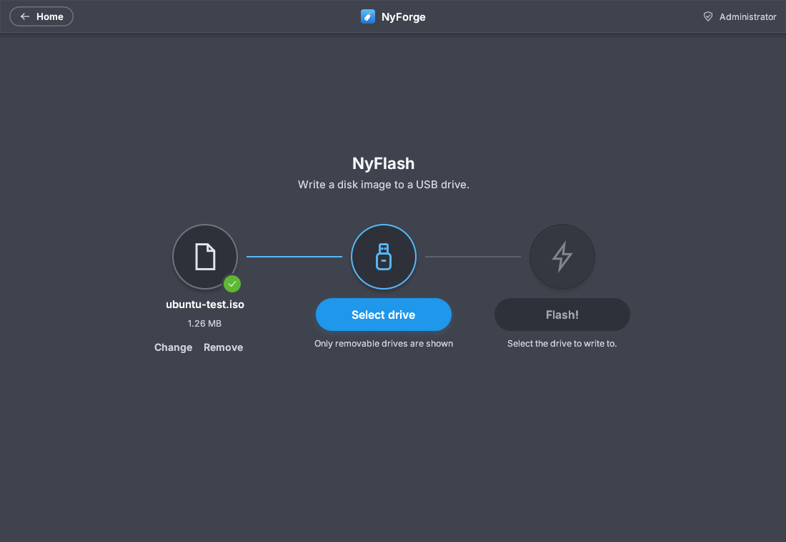

<p align="center"></p>

<h1 align="center">NyForge</h1>

<p align="center">
  A fast, small, native USB toolkit for Linux, macOS and Windows.<br>
  Flash images, build a multiboot drive, format USB sticks. Rust, no telemetry, no account.
</p>

<p align="center">
  
  
</p>

| Tool | What it does | Command |
|---|---|---|
| **NyFlash** | Writes `.iso` / `.img` files (and `.gz` `.xz` `.bz2` `.zst` `.zip` archives of them) to a USB drive. | `nyforge flash` |
| **NyBoot** | Multiboot drive: install once, copy ISOs onto it like files, pick one at boot. Not Ventoy-compatible. | `nyforge boot` |
| **NyFormat** | Erases and formats USB sticks and SD cards (FAT32, exFAT, FAT16, NTFS, ext2/3/4 where the system allows), checks for bad blocks and fake capacity, restores a drive stuck at a few MB. | `nyforge format` |

A desktop app (`nyforge-gui`) and a command line (`nyforge`) share one engine; the app never touches a drive itself.
Keys: **Ctrl+1/2/3** (**Cmd** on macOS) open the tools, **Alt+Left** (**Cmd+[**) goes back, **F11** full screen.
The window shrinks to a quarter-screen tile, so it works in tiling window managers such as Hyprland.

**Safety:** the disk your system runs from is never listed, and NyFormat lists only removable USB drives and SD cards.
System, internal and virtual disks are refused by the engine, with no override. Every write asks first and re-checks
the drive right before starting.

> **Version 0.1, young software.** Read [What has been tested](#what-has-been-tested) before trusting it with a
> drive that holds anything you care about.

## Install

### Linux and macOS: `./install.sh`

Open a terminal in the project (or unpacked download) folder and run **one** of these:

```sh
./install.sh --user      # for you only, no password, installs to ~/.local (recommended)
sudo ./install.sh        # for everyone on this computer
```

From source (git clone or `nyforge-source.tar.gz`) it builds first, which needs [Rust](https://rustup.rs) 1.88+, Git
and a C compiler, and takes a few minutes. Then open **NyForge** from the applications menu or run `nyforge-gui`.
Check with `nyforge --version`; remove with `./install.sh --user --uninstall` (or `sudo ./install.sh --uninstall`).

* **"Permission denied"**: you ran it without `--user` or `sudo`. Add one.
* **"command not found"**: wrong folder. `cd` to the folder that holds `install.sh`.
* **Rust missing under `sudo`**: use `--user`, or run `rustup default stable` for your own account. The installer
  builds as you and only installs as root.
* **No menu entry after `--user`**: put `~/.local/bin` on your `PATH`, then log out and in once.
* **macOS**: `--user` puts `NyForge.app` in `~/Applications` (`sudo` uses `/Applications`). The app is not signed
  yet; the installer clears the quarantine mark. If you copied it by hand: `xattr -dr com.apple.quarantine NyForge.app`
  or right-click > **Open**. If macOS says "Operation not permitted" when writing, allow NyForge under Privacy &
  Security > Full Disk Access (or Removable Volumes).

### Windows

Download the `.zip` from **Releases**, extract it, then **double-click `install.cmd`**, and open **NyForge** from the Start
menu. (Windows blocks the unsigned `install.ps1` itself with "is not digitally signed"; `install.cmd` starts it safely.
Remove NyForge with `install.cmd -Uninstall` in a terminal.) Writing to a drive needs administrator rights; the app
offers **Restart as administrator** (UAC prompt). The program is not code-signed yet, so SmartScreen may warn:
**More info > Run anyway**.

### Downloads (Releases page)

| System | File |
|---|---|
| Linux x86-64 (glibc 2.35+) | `nyforge-<version>-linux-x86_64.tar.gz` (app + command line) |
| macOS 11+ (Apple Silicon and Intel) | `nyforge-<version>-macos-universal.tar.gz` |
| Windows 10/11 x86-64 | `nyforge-<version>-windows-x86_64.zip` |
| Older Linux, ARM64, Alpine | `nyforge-cli-<version>-linux-<arch>[-musl].tar.gz` (command line only; build from source for the app) |

Each has a `.sha256` file: `sha256sum -c <file>.sha256` (Linux), `shasum -a 256 -c <file>.sha256` (macOS),
`Get-FileHash <file>` (Windows). Unpack, `cd` into the folder, run `./install.sh --user`.

### What Linux needs

NyForge brings its own FAT32/exFAT code, so there is little to install; most desktops already have all of this.
On Arch / Omarchy (anything installed is skipped):

```sh
sudo pacman -S --needed mesa libxkbcommon wayland libx11 polkit xdg-desktop-portal xdg-desktop-portal-hyprland e2fsprogs ntfs-3g
```

| Needed for | Debian / Ubuntu | Fedora |
|---|---|---|
| App window (OpenGL, Wayland or X11) | `libgl1 libxkbcommon0 libwayland-client0 libx11-6` | `mesa-libGL libxkbcommon wayland-libs-client libX11` |
| Password window when writing | `policykit-1` | `polkit` |
| File chooser | `xdg-desktop-portal` + a backend (`-gtk`, `-gnome`, `-kde`, `-hyprland`) | same |
| ext4 formatting (optional) | `e2fsprogs` | `e2fsprogs` |
| NTFS formatting (optional) | `ntfs-3g` | `ntfs-3g` |

Without `e2fsprogs` or `ntfs-3g` the app just does not offer ext4 or NTFS. Building also needs
`sudo pacman -S --needed rustup base-devel git && rustup default stable`. Writing asks for your password through
polkit; the app itself never runs as root. You can also drag an image onto the NyFlash window.

Manual build: `cargo build --release -p nyforge -p nyforge-gui`, then `./target/release/nyforge-gui`. Keep `nyforge`
and `nyforge-gui` in the same folder: the app finds the engine next to itself.

## Using the app

* **NyFlash**: choose an image (button or drag and drop), choose a drive, **Flash...**, confirm. Real progress, safe stop.
  No drive is ever pre-selected.
* **NyBoot**: choose a drive, install NyBoot (erases it), then **Add images**. Removing an image deletes only that file;
  **Reinstall** erases the drive. "Update bootloader" is shown disabled (no in-place update yet). Each image is checked
  when added; some (e.g. Windows installers) cannot boot from a loop device and NyForge says so.
  * A drive with `NYBOOT` / `NYBOOT-EFI` partitions is marked "NyBoot drive" and chosen for you when it is the only one.
  * **No app needed to add images:** the big `NYBOOT` partition is plain exFAT. Copy `.iso` files onto it with your
    file manager, in any folder; they appear in the boot menu next start (tested in an emulator with an independent
    exFAT driver, fragmented files, spaces in names, sub-folders, BIOS and UEFI).
  * **Unknown ISOs:** no recipe needed per distro. Unknown images get a generic start (kernel + initrd found on the
    image); images with their own `grub.cfg` can use it. This is why distros Ventoy-style tools struggle with, such as
    CachyOS, are meant to work (unproven on real ISOs).
  * **Start-up:** Arch-family images (Arch, CachyOS, EndeavourOS...) are started by NyBoot itself, because their own
    menu searches every partition of every disk first and is slow. For an image's own menu put `<image>.iso.nyboot.cfg`
    next to it with `set nb_profile="loopbackcfg"`; the same file can add options, e.g. `set nb_params="nomodeset"`.
* **NyFormat**: choose a drive, a filesystem (only ones this system can make), a label and cluster size, then
  **Format!**. Options: **Quick format**, **Check device for bad blocks** (1 to 4 passes), and **Restore full capacity**
  for a drive that shows only a few MB after flashing an ISO. A cancelled flash leaves such a drive; this fixes it.
* Closing the window during a write asks first, then stops it. Progress and errors are the engine's own; nothing is
  simulated. There is no "verified" claim, because writes are not read back. Animations follow "reduce motion".

## Command line

Everything the app does is `nyforge`, plus Windows installer media, Raspberry Pi first-boot setup and drive cloning.
Add `--json` for one JSON event per line (how the app talks to the engine). Drives are named as your system names
them (`/dev/sdb`, `/dev/disk4`, `\\.\PhysicalDrive2`); `nyforge list` shows them. Use `sudo` on Linux/macOS, an
Administrator terminal on Windows.

```sh
nyforge list                                   # drives you can write to
nyforge inspect ubuntu.iso                     # what is this image?
sudo nyforge flash ubuntu.iso /dev/sdb         # write it (asks first)
sudo nyforge flash raspios.img.xz /dev/sdb /dev/sdc --hostname mypi --user me --ssh --ssh-key ~/.ssh/id_ed25519.pub
sudo nyforge windows Win11.iso /dev/sdb --bypass-checks
sudo nyforge boot install /dev/sdb             # multiboot drive
sudo nyforge boot add /dev/sdb *.iso
nyforge boot check some.iso
sudo nyforge format /dev/sdb --fs exfat -l HOLIDAY
sudo nyforge format /dev/sdb --scheme gpt --partition fat32:16G:WIN --partition ext4::LINUX
sudo nyforge format /dev/sdb --check-bad-blocks --passes 2         # write and read back the whole drive twice (finds bad blocks and fakes)
sudo nyforge format /dev/sdb --test-capacity full --wipe zero      # unmask fake capacity, then erase
nyforge format --list                          # what could be formatted (never internal disks)
nyforge clone /dev/sdb backup.img.zst
nyforge doctor                                 # does this machine have what NyForge needs?
```

`-y/--yes` skips confirmation. Writing to a file path (`nyforge flash x.iso out.img`) never needs root.
Exit codes: 0 success, 1 failure, 2 bad usage, 130 cancelled.

## Build and test

```sh
cargo build --release -p nyforge -p nyforge-gui
cargo test -p nyforge-core
# QEMU boot tests need qemu-system-x86_64, OVMF, parted, mtools, dosfstools, grub, wimlib, xorriso:
tools/make-test-kernel.sh /some/dir
NYFORGE_TEST_KERNEL_DIR=/some/dir cargo test -p nyforge-core --test nyboot_qemu --test winmedia_qemu -- --ignored --test-threads=1
```

GRUB code in `assets/grub` is prebuilt (`tools/build-grub-assets.sh` rebuilds it from distro GRUB).

## What has been tested

**Run and passing on Linux x86-64** (automated tests, image files and a loop device, never a physical stick):
writing, zero-skipping, multi-target, cancellation, decompression; ISO9660/UDF readers; splitting `install.wim` and
the FAT32 result (`fsck.vfat`, `wimlib-imagex`); QEMU boots of a NyBoot drive with a real kernel and of a
Windows-style stick (BIOS + UEFI, stand-in Windows files); first-boot files against cloud-init and Raspberry Pi
formats; `nyforge format` (FAT16/32, exFAT, NTFS, ext4 checked with `fsck.vfat`, `fsck.exfat`, `e2fsck`, `ntfsfix`,
`blkid`; MBR and GPT checked with `parted`; capacity test against simulated fakes; O_DIRECT path and wipes on a loop
device; refusal of system, internal, virtual and read-only drives); the desktop app under a virtual display with real
engine runs (flash and compare byte for byte, NyBoot install/add/remove, NyFormat, failed runs, drive removed
mid-way, closing during a write, keyboard use, the Windows "restart as administrator" notice previewed on Linux);
NyBoot file-manager drop-in; and the portable glibc 2.17 build starting on Linux.

**Written to be portable, unit-tested on Linux, never run on the real system:** the macOS and Windows host code.
The decisions that matter (macOS `diskutil` parsing and safe-drive rules, Windows PowerShell drive list, drive names,
NTFS script) are plain functions with tests that run everywhere. The OS calls themselves (`/dev/rdiskN`,
`F_NOCACHE`, `diskutil unmountDisk`, `DeviceIoControl`, the Windows elevation check, `Format-Volume`) were never
compiled or run by the author. CI builds and tests on real macOS and Windows runners, lists drives there and tries
a RAM disk (macOS) and a virtual disk (Windows); those two steps may fail until someone has seen them pass. If you
run NyForge there first, you are the first tester: use a spare stick.

**Not tested at all:**
* The desktop app on macOS and Windows (CI only compiles it), the Linux polkit window and native file chooser, and
  the app writing to a physical stick on any system.
* A real Windows Setup boot (UEFI path uses the ISO's own loader; legacy BIOS `ntldr` path is less proven) and the
  Windows 11 check-bypass answer file.
* Real Raspberry Pi first boot (files follow Raspberry Pi's documentation; newer releases may differ for Wi-Fi,
  hostname, time zone).
* `nyforge format` on a real drive's partitions (the kernel creating `/dev/sdb1`; naming/waiting code is unit-tested).
* The Linux ARM64 and musl builds (started by CI under an emulator only).
* The quick capacity test on a counterfeit stick (full mode is proven against simulated fakes; quick mode can miss
  one whose real size is not a multiple of the sampling distance).
* NyBoot on real ISOs: profiles for Debian-live, Arch-family (Arch, EndeavourOS, CachyOS, Garuda, SystemRescue),
  Manjaro, Fedora-style, own-`grub.cfg` images and the generic fallback are checked against ISO layouts in an
  emulator, not on real ISOs. The CachyOS one follows CachyOS's published boot options.

## Known limits

* NyBoot: no Secure Boot, no persistence, no ISOs that cannot boot from a loop device. The app cannot update NyBoot in
  place; reinstalling erases the drive.
* MBR only for NyBoot; drives up to 2 TiB with 512-byte sectors. `install.esd` over 4 GiB is not supported.
* Writes are not read back to verify (only the format capacity test reads back).
* `nyforge format` makes FAT16/FAT32/exFAT itself on every system. ext2/ext3/ext4 and NTFS need Linux with `mkfs.ext4` /
  `mkfs.ntfs` (`nyforge doctor` checks); on Windows NTFS is made by Windows (needs a partition table); macOS can make
  neither. 512-byte-sector drives only; drives over 2 TB default to GPT, which cannot be combined with
  `--fit-real-capacity`.
* Windows 10 or newer (the drive list uses PowerShell's Storage module). The macOS download is one universal build whose
  Intel half is only cross-compiled by CI. No Windows ARM64 download.
* macOS and Windows builds are not code-signed or notarized.

## Contributing and publishing

Maintainers: [docs/PUBLISHING.md](docs/PUBLISHING.md) covers putting the repository on GitHub and publishing a release.

## License

GPL-3.0-or-later. See `LICENSE` and `THIRD-PARTY.md`.
